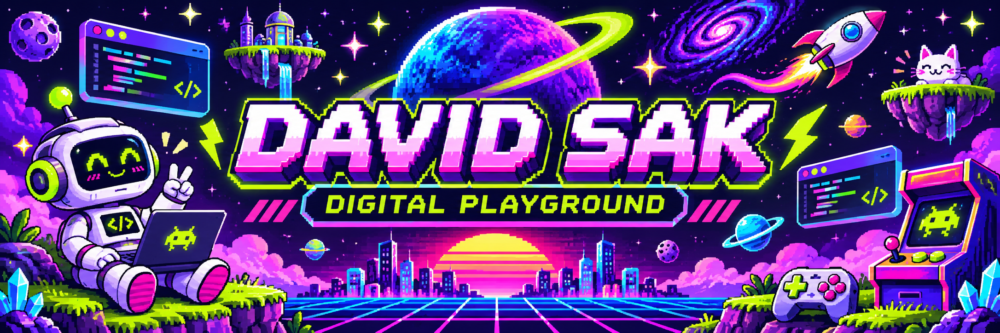

<div align="center">

### 👾 PLAYER 01: DAVID SAK

**Developer · AI builder · professional idea explorer**

I turn curious ideas into useful things: AI agents, automations, data pipelines and websites.
From the first sketch to the final deploy. 🚀

[🌐 Website](https://www.dsak.tech/) &nbsp; · &nbsp; [💼 LinkedIn](https://www.linkedin.com/in/sak-david) &nbsp; · &nbsp; [✉️ Say hello](mailto:business@dsak.tech)

</div>

---

## 🕹️ Choose your world

🧠 **[Cortexia](https://cortexia-alpha.vercel.app/cs)**  
A company brain built to connect tools, knowledge and decisions.

🌐 **[SiteSpot](https://sitespot.cz)**  
The studio I co-founded to build websites and automations for businesses.

🌌 **[Exotic Compact Objects](https://github.com/Dawe583/exotic-compact-objects)**  
Exploring the universe through astrophysics and research.

🔭 **[Astro Science](https://github.com/Dawe583/astro-science)**  
Another corner of my playground dedicated to astronomy and science.

## ⚡ Player inventory

```text
🧠 AI agents & LLM applications    ██████████  equipped
🤖 Automation & data pipelines     ██████████  equipped
🌐 Websites & digital products     ██████████  equipped
🔭 Science & cosmic curiosity      ██████████  always on
```

## 🎯 Current mission

Build useful things, experiment with new ideas and make technology work for people.

<div align="center">

**Have a wild idea? Let's make it real.**  
[Start a conversation →](mailto:business@dsak.tech)

✦ &nbsp; MADE ON PLANET EARTH &nbsp; ✦ &nbsp; EXPLORING EVERYTHING ELSE &nbsp; ✦

</div>
