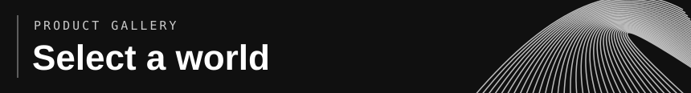
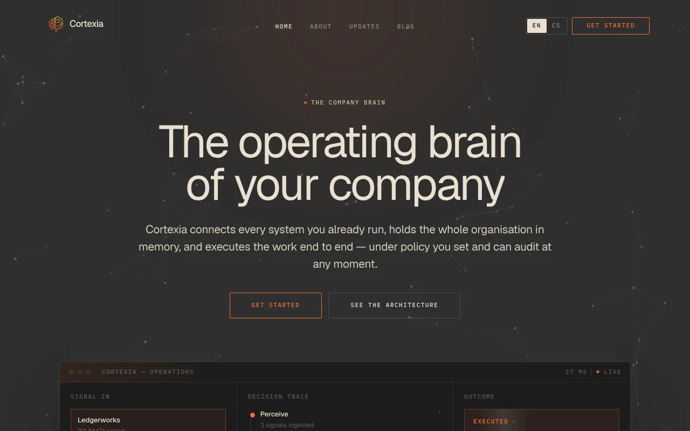
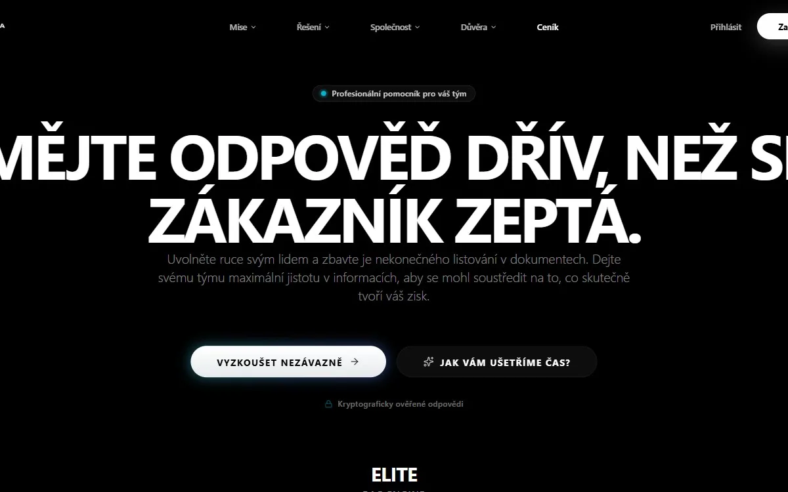
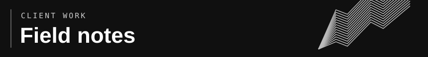
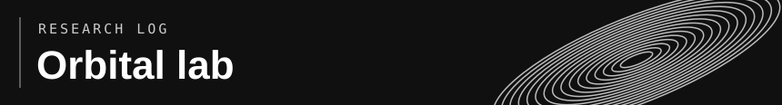

PLAYER 01　 /　 PLZEŇ, CZECHIA

## Hi, I’m David.

I’m a freelance developer and co-founder of **SiteSpot**. I design, write and deploy software for businesses. My favourite part of a project is tracing a complicated job back to one small question. Where did this answer come from? Why did the team make that decision? Which step is somebody still doing by hand?

My other workspace is an astrophysics lab built out of notebooks. You can explore both sides of my work here.

[Products](#products) · [Client work](#client-work) · [Research](#research) · [How I build](#how-i-build) · [Contact](#co-op-mode)

| **Cortexia** | **Leadora** |
| :--- | :--- |
|  |  |
| **Why did we decide that?** Cortexia connects the tools a team already uses and keeps the reason behind a decision alongside the decision itself. | **Where does the manual say that?** Leadora helps technical pre-sales teams answer questions from company documentation. Each answer points back to its source. |
| [Open Cortexia ↗](https://cortexia-alpha.vercel.app/cs) | [Read about Leadora ↗](https://www.dsak.tech/en/about) |

**[SiteSpot ↗](https://sitespot.cz)** is the studio I co-founded for websites and automation. My work spans the first process sketch, the software itself and the handover to the people who will run it.

### From a company list to a sales shortlist

For **Galochrom**, I worked with a pool of **228 chemical and pharmaceutical companies** across Germany, Switzerland and the Netherlands. The resulting dataset identified **143 highly relevant companies** and included **322 verified email addresses**. Company fit and contact verification answer two different questions. Sales needs both before reaching out.

| Project | What I built |
| :--- | :--- |
| **MedicalStore.cz** | A system that finds potential B2B buyers, verifies them and scores their fit. |
| **Optik Dvořák** | A client website for a local optician in Plzeň. |
| **Autoservis Topinka** | A website for an auto service business in Plzeň. |

[Explore my portfolio ↗](https://www.dsak.tech/)

### What can a notebook tell us about a black hole?

**[Exotic Compact Objects ↗](https://github.com/Dawe583/exotic-compact-objects)** is where I explore black holes, wormholes and white holes. The repository brings theoretical models together with gravitational-wave data from GWOSC and catalogues from HEASARC.

| If you’re curious about… | Start here |
| :--- | :--- |
| **The mathematics** | The equation derivations and geodesics notebooks show how to move from a model to a calculated path. |
| **The observations** | The gravitational-wave strain and remnant-catalogue notebooks work with measurements and catalogue records. |
| **The wider workspace** | [Astro Science](https://github.com/Dawe583/astro-science) collects simulation tools, scientific Python notebooks and an Obsidian knowledge base. |

[Browse the research portal ↗](https://dawe583.github.io/exotic-compact-objects/)

## How I build

1. **Map one real workflow.** I follow a document or request from arrival to handoff. That tells me which systems have to talk and where someone makes a judgement call.
2. **Pick the smallest useful tool.** A repeatable rule goes into code. For a question over a document collection, I build retrieval and show the source with the answer.
3. **Give exceptions an owner.** Routine cases can go straight through. An uncertain case goes to a person along with the information needed to decide.
4. **Check the result in operation.** I look at processing time, errors and cost per transaction. The client gets the code, documentation and access.

<strong>Open my toolkit</strong>

- **Knowledge systems** · Private document search, retrieval-augmented generation and LLM applications with citations.
- **Integrations** · Data pipelines connecting CRM, warehouse and accounting systems.
- **Scientific computing** · Python, Jupyter and symbolic calculations for exploring physical models.
- **Monitoring** · My [TypeScript crypto tracker](https://github.com/Dawe583/crypto-tracker) watches EVM activity and new pools, sends alerts and can run on a Raspberry Pi.

---

## Co-op mode

**What would you automate first?** Tell me which task keeps coming back, what goes into it and who needs the result. That’s usually enough to start sketching.

[Email me](mailto:business@dsak.tech)　·　[Portfolio](https://www.dsak.tech/)　·　[LinkedIn](https://www.linkedin.com/in/sak-david)
